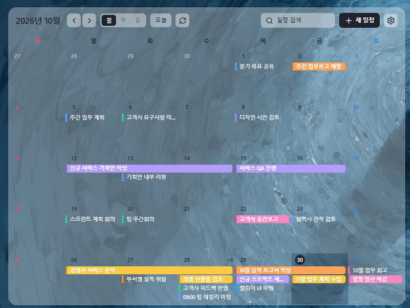
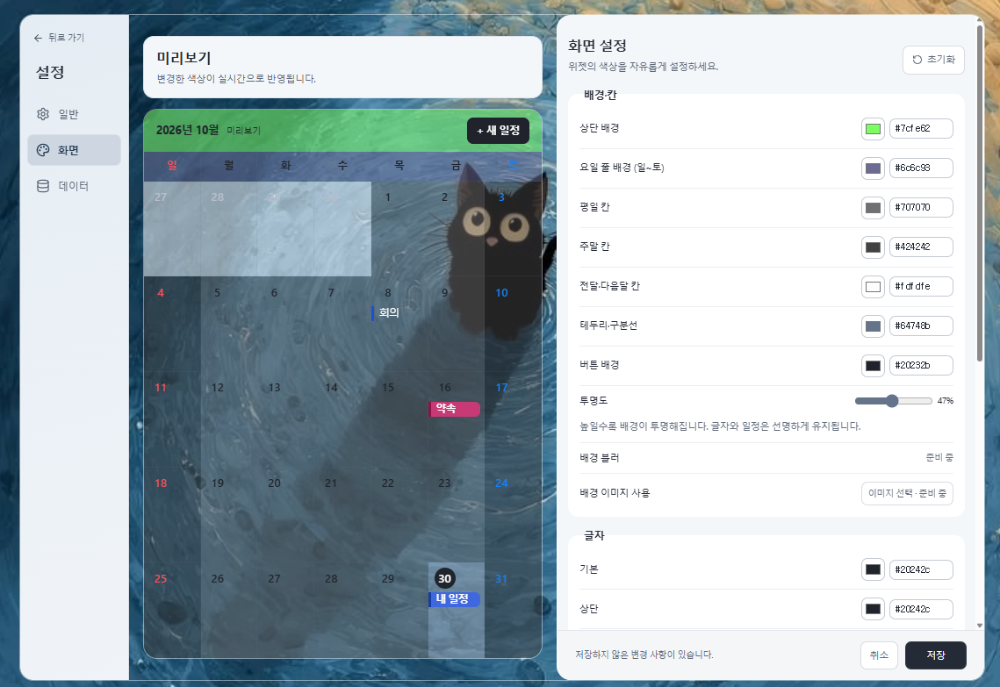

# 꾸로그

## 프로젝트 소개

**Windows 바탕화면에서 바로 일정을 확인할 수 있는 캘린더 위젯**

일정을 확인할 때마다 캘린더 프로그램을 따로 여는 게 번거로워서 만들기 시작했습니다.
다른 프로그램을 사용하다가 바탕화면으로 돌아오면 일정과 메모를 바로 볼 수 있게 하는 게 목표였습니다.

### 주요 기능

- 일정 추가, 수정, 삭제
- 여러 날에 걸친 일정 표시
- 일정 검색
- 날짜별 전체 일정 확인
- 메모 작성
- 일정 색상 설정
- 배경색, 글자색, 글꼴, 투명도 변경
- 창 크기에 따라 표시할 일정 수 조절
- 표시하지 못한 일정은 +N으로 표시

## 사용 기술

| 구분 | 기술 | 선택한 이유 |
| --- | --- | --- |
| 프론트엔드 | React 19, TypeScript, Vite | 달력처럼 상태에 따라 자주 바뀌는 화면을 컴포넌트로 나눠 관리하기 위해 사용 |
| 스타일 | Tailwind CSS, CSS | 일반적인 스타일은 Tailwind로 처리하고 달력 배치처럼 세밀한 부분은 CSS로 조절 |
| 상태 관리 | Zustand | 설정 값과 미리보기 상태처럼 여러 컴포넌트에서 공유하는 상태를 단순하게 관리하기 위해 사용 |
| 날짜 처리 | date-fns, React Day Picker | 월간 범위 계산, 날짜 비교, 날짜 선택 기능을 직접 구현하는 부분을 줄이기 위해 사용 |
| 데스크톱 | Tauri 2, Rust, Windows API | React 화면을 Windows 데스크톱 앱으로 만들고 로컬 기능을 처리하기 위해 사용 |
| 데이터베이스 | SQLite, rusqlite | 별도 DB 서버 없이 일정 데이터를 PC에 저장하기 위해 사용 |

## 데이터 흐름
일정 조회와 저장은 아래 순서로 처리합니다.
```
React
  ↓
Tauri invoke
  ↓
Rust
  ↓
SQLite
```
일정처럼 계속 남아 있어야 하고 조회가 필요한 데이터는 SQLite에 저장합니다.

색상, 글꼴, 투명도처럼 화면에서만 사용하는 설정은 localStorage에 따로 저장했습니다.


## 만들면서 고민했던 것

### 서버가 꼭 필요할까?

처음에는 Express와 PostgreSQL을 사용했습니다.

웹 프로젝트를 만들던 방식대로 시작했는데, 막상 바탕화면 위젯으로 사용하려고 하니 앱 하나를 쓰기 위해 서버와 DB까지 같이 실행해야 했습니다.

혼자 사용하는 로컬 앱인데 이 구조가 필요한지 다시 생각하게 됐습니다.

결국 Express와 PostgreSQL을 빼고 Tauri와 SQLite로 바꿨습니다.

```tsx
//기존
React → Express → PostgreSQL


//변경
React → Tauri invoke → Rust → SQLite
```

---

### React에서 SQLite까지 어떻게 연결할까?

SQLite를 사용하기로 한 뒤에는 React에서 DB를 어떻게 다룰지도 정해야 했습니다.

React 코드에서 데이터를 직접 처리하기보다는 Tauri의 invoke를 이용해 Rust 함수를 호출하고, DB 접근은 Rust 쪽에서 하도록 했습니다.

예를 들어 일정 조회를 요청하면 React에서는 조회 기간만 전달하고, 실제 SQLite 조회는 Rust에서 처리합니다.

처음에는 Tauri의 invoke 방식이 익숙하지 않았지만, 구현하면서 프론트 화면과 로컬 데이터 처리가 어디에서 나뉘는지 이해하는 데 도움이 됐습니다.

---

### 달력에 보이는 날짜는 어디까지 조회해야 할까?

처음에는 현재 월의 시작일부터 마지막 날까지만 일정을 가져오려고 했습니다.

그런데 월간 달력에는 이번 달 날짜만 나오는 게 아니라 이전 달과 다음 달 날짜도 같이 표시됩니다.

예를 들어 11월 달력을 보고 있어도 첫 번째 주에 10월 날짜가 들어갈 수 있습니다.

그래서 현재 월 기준이 아니라 실제 화면에 표시되는 첫 날짜부터 마지막 날짜까지 조회하도록 바꿨습니다.

```tsx
const rangeStart = startOfDay(start);
const rangeEnd = addDays(startOfDay(end), 1);

const events = await invoke<SavedEvent[]>("fetch_events", {
  start: rangeStart.toISOString(),
  end: rangeEnd.toISOString(),
});
```

종료 날짜는 다음 날 0시로 잡아 마지막 날짜에 있는 일정도 조회 범위에 포함했습니다.

---

### 월을 빨리 넘기니까 이전 데이터가 다시 보였다

월을 빠르게 넘겨보다가 현재 달의 일정이 표시된 뒤 이전 달 데이터가 다시 나타나는 경우가 있었습니다.

처음에는 화면 문제라고 생각했는데, 확인해보니 먼저 시작한 조회가 항상 먼저 끝나는 것은 아니었습니다.

> 예를 들어, 11월 조회 시작 → 12월 조회 시작 → 12월 조회 완료 → 11월 조회 완료

이 순서가 되면 마지막에 끝난 11월 조회 결과가 다시 화면에 들어올 수 있습니다.

그래서 요청마다 번호를 붙이고 가장 마지막에 시작한 요청일 때만 결과를 반영하도록 했습니다.

```ts
const data = await load();

if (requestId === latestRequestId) {
  callbacks.success(data);
}
```

같은 확인을 오류 처리와 로딩 상태에도 넣어 이전 요청이 현재 화면에 영향을 주지 않도록 했습니다.

---

### 여러 날에 걸친 일정은 어떻게 그릴까?

하루 일정은 해당 날짜 칸 안에 넣으면 됐지만, 여러 날에 걸친 일정은 조금 달랐습니다.

처음에는 시작일부터 종료일까지 하나의 막대로 이어서 표시하려고 했습니다.

그런데 월간 달력은 한 줄이 한 주이기 때문에 토요일부터 다음 주 월요일까지 이어지는 일정처럼 주를 넘어가는 경우를 그대로 그리기 어려웠습니다.

그래서 일정이 주를 넘어가면 먼저 구간을 나눴습니다.

```
토요일 ~ 월요일

이번 주   : 토요일
다음 주   : 일요일 ~ 월요일
```
그 다음 각 줄에서 마지막으로 사용한 위치를 기록하고, 다음 일정이 들어갈 수 있는 줄을 찾았습니다.

1. 시작일과 종료일 기준으로 주 단위 구간 생성
2. 각 구간의 시작 위치와 길이 계산
3. 각 줄의 마지막 일정 위치 저장
4. 들어갈 수 있는 첫 번째 줄에 배치
5. 자리가 없으면 새 줄 생성

```ts
let row = rowEnds.findIndex(end => end <= segment.colStart);
if (row === -1) row = rowEnds.length;

rowEnds[row] = segment.colStart + segment.span;
bars.push({ ...segment, row });
```

창이 작아지면 모든 일정을 그대로 보여주는 것도 문제가 됐습니다.

날짜 칸에 들어갈 수 있는 일정 수만 표시하고, 나머지는 +N으로 보여주도록 했습니다.
숨겨진 일정은 날짜를 누르면 전체 목록에서 확인할 수 있습니다.

---

### 모든 상태를 Zustand에 넣어도 될까?
Zustand를 사용하면서 처음에는 필요한 상태를 전역 스토어에 계속 추가하는 방식으로 만들었습니다.

그런데 일정 편집창에서만 사용하는 값까지 전역으로 올리다 보니 오히려 어떤 상태가 어디에서 사용되는지 찾기 어려워졌습니다.

그래서 지금은 대략 아래 기준으로 나누고 있습니다.

```
여러 컴포넌트에서 같이 사용하는 값
→ Zustand

특정 컴포넌트 안에서만 사용하는 값
→ useState

앱을 다시 실행해도 남아 있어야 하는 화면 설정
→ localStorage

일정 데이터
→ SQLite
```

## AI 활용

테스트 코드 작성과 오류 원인 확인에 AI를 사용했습니다.


## 프로젝트 구조

```text
frontend/
├── src/
│   ├── app/                 # 앱 진입과 라우팅
│   ├── features/calendar/   # 달력, 일정 편집, 조회와 배치 로직
│   ├── routes/              # 달력과 설정 페이지
│   ├── layouts/             # 공통 레이아웃과 창 크기 처리
│   ├── store/               # 화면 설정 상태
│   └── ui/                  # 모달, 날짜 선택 등 공통 UI
├── src-tauri/src/           # SQLite 접근과 Windows 창 동작
└── tests/                   # 프론트엔드 테스트
```

### 실행 환경
Windows 11에서 개발하고 테스트했습니다.

```powershell
cd frontend
npm install
npm run tauri -- dev
```

배포용 설치 파일은 아래 명령으로 생성했습니다.
```
npm run tauri -- build
```
자세한 환경 설정과 데이터 보관 방법은 [setup.md](docs/setup.md)에 정리했습니다.


## 주요 기능

### 월간 달력

<!-- 월간 달력 화면 캡처 -->


- 일정 추가, 수정, 삭제
- 날짜별 메모 작성
- 현재 달력에 표시된 기간의 일정 검색
- 여러 날에 걸친 일정 표시
- 날짜 클릭 시 해당 날짜의 전체 일정 확인
- 일정바 더블 클릭으로 바로 수정
- 창 크기에 따라 표시할 일정 수 조절
- 화면에 다 보이지 않는 일정은 `+N`으로 표시

### 화면 설정

<!-- 화면 설정 캡처 -->


- 배경색, 글자색, 글꼴, 투명도 변경
- 실제 달력 컴포넌트를 사용한 설정 미리보기
- 변경 사항 저장 및 취소
- 기본값으로 미리보기
